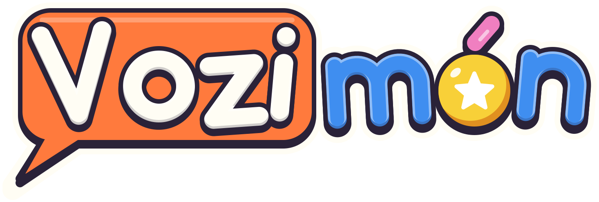
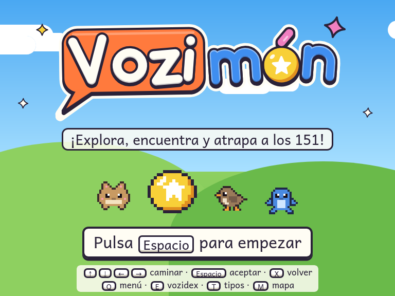
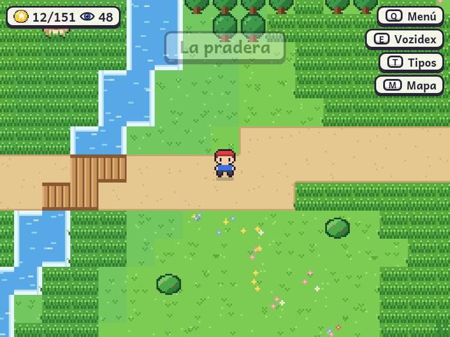
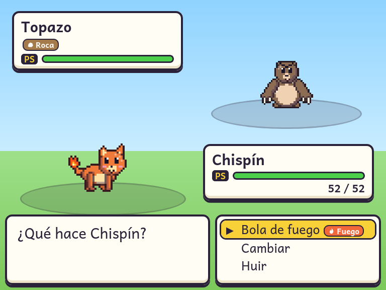
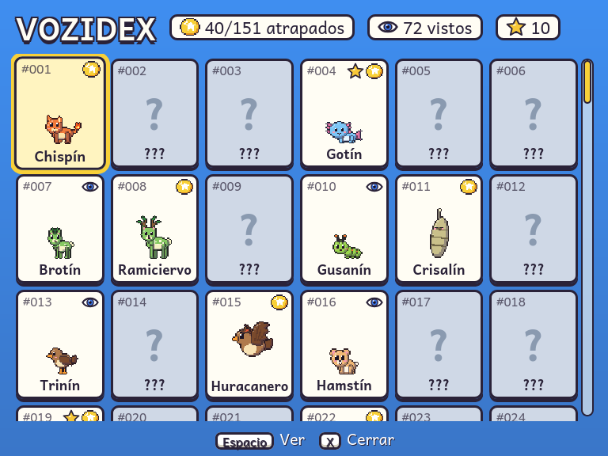
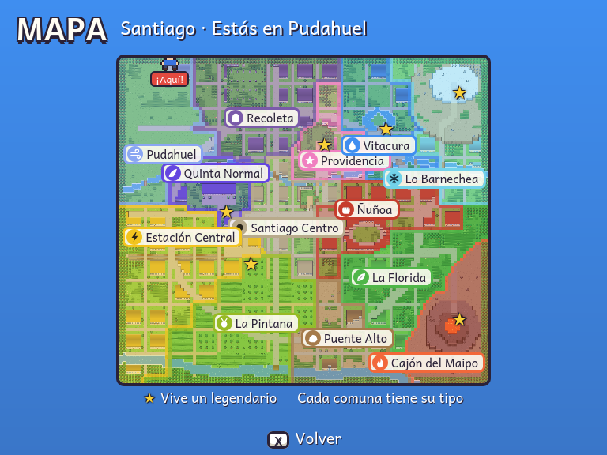
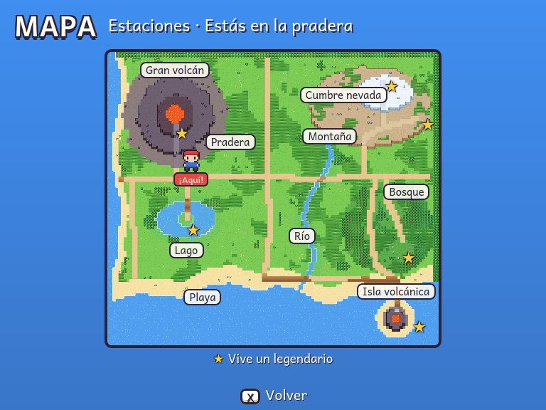
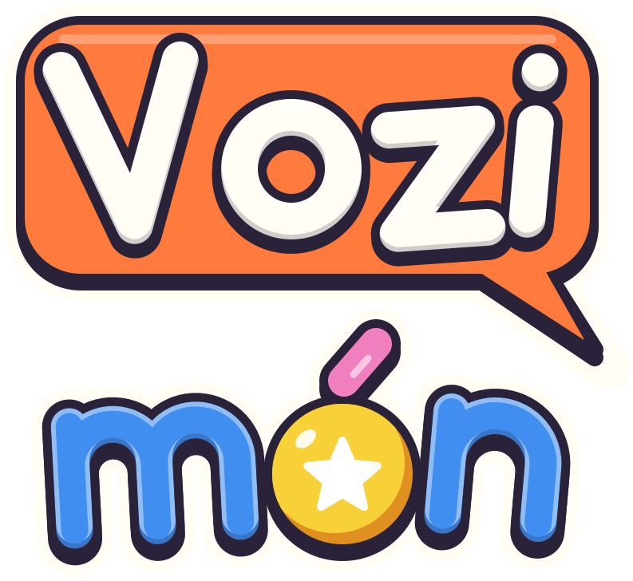
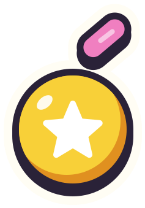
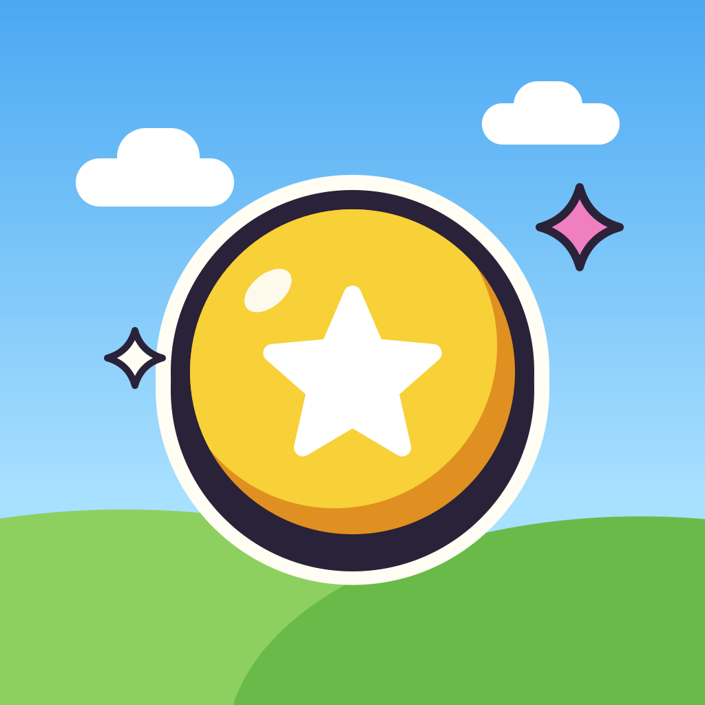

<p align="center">
  
</p>

<p align="center">
  <b>¡Explora, encuentra y atrapa a los 151!</b><br>
  Juego educativo en español para peques de 4 a 6 años que están aprendiendo a leer.
</p>

<p align="center">
  
  
  
  
  <a href="LICENSE"></a>
</p>

<p align="center">
  <a href="#-cómo-jugar">Cómo jugar</a> ·
  <a href="#-run-it">Run it</a> ·
  <a href="#-project-layout">Project layout</a> ·
  <a href="#-marca--brand">Marca</a> ·
  <a href="#-licencia--license">Licencia</a>
</p>

<p align="center">
  
</p>

An educational creature-collecting game in Spanish for children aged 4–6: roam an open world,
meet 151 original creatures, win turn-based fights, fill the Vozidex and **read each creature's name
out loud** to earn a star. All creatures, art, sounds and music are original. Runs in any modern
browser, on desktop, tablet and phone.

## ✨ Qué tiene

<table>
  <tr>
    <td width="50%"></td>
    <td width="50%"></td>
  </tr>
  <tr>
    <td><b>Un mundo abierto</b>: caminos, hierba alta, montañas, playa, volcanes, lago y bosque. Los Vozimón pasean por el mundo y se esconden en la hierba.</td>
    <td><b>Combates por turnos</b>: un ataque por Vozimón, cada uno con su propia animación y sonido. Si ganas, ¡atrápalo con la bola estrella!</td>
  </tr>
  <tr>
    <td></td>
    <td></td>
  </tr>
  <tr>
    <td><b>El Vozidex</b>: 151 páginas por descubrir. Lee el nombre de cada Vozimón en voz alta y gana una estrella.</td>
    <td><b>Dos mundos</b>: <i>Estaciones</i> y un <i>Santiago</i> imaginario, con una comuna para cada uno de los 13 tipos.</td>
  </tr>
</table>

<p align="center">
  
  
  
  &nbsp;&nbsp;
  
  
  
  
  
  
  <br>
  <sub>Los tres compañeros para empezar y los seis legendarios. ¿Y el número 151…?</sub>
</p>

## 🎮 Cómo jugar

| Tecla | Acción |
| --- | --- |
| **Flechas** | caminar |
| **A** (Espacio) | aceptar |
| **B** (X) | volver · mantener para correr |
| **Q** | menú |
| **E** | Vozidex |
| **T** | tabla de tipos (¿quién gana a quién?) |
| **M** | mapa |

- Cada acción tiene una sola tecla, y todas se pueden cambiar en *Ajustes → Teclas*; las pistas en pantalla muestran siempre la tecla elegida. Al escribir el nombre, *Intro* confirma y *Esc* vuelve.
- En tablets y teléfonos aparecen flechas y botones ✓ (aceptar) / ✗ (volver) en pantalla; «Menú», «Vozidex», «Tipos» y «Mapa» se tocan en la esquina. También funcionan los mandos (gamepads).
- Para aprender a leer: *Ajustes → Letra* elige entre la letra «Fina» (clara, pensada para quien empieza a leer) y la letra «Píxel», y *Ajustes → Mayúsculas* lo escribe todo en mayúsculas.

### 🎤 Leer en voz alta

En la página del Vozidex de un Vozimón, el niño pulsa «Leer» y lee su nombre al micrófono (al
atraparlo por primera vez hay que leerlo una vez para seguir; después se puede practicar en el
Vozidex). También se pueden practicar los Vozimón que solo se han visto. Si lo lee bien, gana una
estrella; si no, el nombre aparece en sílabas de colores para intentarlo otra vez (con la ✕ de la
esquina se deja para otro momento; después de atraparlo aparece tras 3 intentos).

Funciona en Chrome, Edge y Safari; donde no se puede escuchar (Firefox, sin permiso para el
micrófono) un adulto confirma con «Lo leyó bien». El navegador puede enviar la voz a Google o Apple
para entenderla; se puede apagar en *Ajustes → Leer en voz alta*.

### Modos

- **Modo normal**: elige un compañero, lucha con tus Vozimón (un ataque cada uno, por turnos) y, si ganas, ¡atrápalo con la bola estrella! Los Vozimón que más luchan salen primero en la lista, con sus victorias / combates en la esquina.
- **Modo fácil** (por ahora no se ofrece al crear una partida; las partidas fáciles que ya existen siguen funcionando): sin peleas, solo lanza la bola estrella. Cuanto más alto el número en el Vozidex, más difícil es atraparlo.

### Mundos

<p align="center">
  
</p>

Al crear una partida eliges el mapa:

- **Estaciones**: volcanes, playa, nieve, bosque, lago y río.
- **Santiago**: un Santiago de Chile imaginario. Cada comuna tiene su tipo: Recoleta (Fantasma, el Cementerio General), Ñuñoa (Lucha, el Estadio Nacional), Pudahuel (Aire, el aeropuerto), Lo Barnechea (Hielo, Farellones), Cajón del Maipo (Fuego, el volcán San José), Estación Central (Eléctrico), Quinta Normal (Dragón, el museo), Providencia (Magia, el cerro San Cristóbal), Vitacura (Agua), La Florida (Planta), La Pintana (Bicho), Puente Alto (Roca) y Santiago Centro (Normal).

Los Vozimón aparecen por el mundo y se esconden en la hierba alta. Los legendarios esperan en
lugares especiales (el cráter del volcán, la cumbre nevada…); el mapa (**M**) los marca con una
estrella. Cuando hayas atrapado a los 150, un Vozimón misterioso empieza a pasear por todo el
mundo: búscalo en el mapa. ¡Es cinco veces más fuerte que los demás!

### Partidas

- Cada partida se guarda sola en el navegador (`localStorage`): el Vozidex al momento, y el estado exacto del juego (dónde estás, los Vozimón del mundo…) cada 5 pasos, después de cada combate y al salir. Al cargar la partida sigues justo donde lo dejaste.
- Una partida se puede guardar en un archivo (`.vozimon`): elige la partida → «Guardar en un archivo». Para seguirla en otro navegador o aparato: «Cargar de un archivo» en la lista de partidas, ponle un nombre nuevo y listo. El archivo solo sirve para pasarla; después ya no hace falta.

## 🛠️ Run it

Requires Node.js and npm.

```bash
npm install
npm run dev            # development server, open the URL it prints
npm run build          # production build in dist/
npm run preview        # serve the production build
npm test               # unit tests (roster, rules, saves, world)
npm run typecheck      # TypeScript check
npm run export-art     # save every creature portrait as a PNG in src/art/ (e.g. 001-chispin.png)
npm run record-attacks # video of all 151 attacks in preview/ (needs Firefox and ffmpeg)
```

The production build is a static site (`dist/`) and can be hosted on any web server.

**Preview URLs** (throwaway game, nothing is saved): `?demo=world|battle|dex|types|map|slots|new|attacks`,
with options such as `&map=santiago`, `&caught=12`, `&team=1,4,7`, `&mode=easy`, `&font=pixel`,
`&upper=1`. For example `http://localhost:5173/?demo=battle&team=1,4,7`.

## 📁 Project layout

```
src/
  game/        creatures, types, battle and catch rules, saves, reading-aloud matching
  art/         pixel-art rasterizer, creature portraits, sprites (+ exported portrait PNGs)
  world/       the two world generators, terrain, simulation and canvas renderer
  system/      keys, input (keyboard / touch / gamepad), audio, files, speech recognition
  components/  React screens: title, saves, world, battle, attack effects, Vozidex, map…
brand/         logos, mark, icons and profile pictures (see brand/README.md)
public/        favicon and web-app icons served by Vite
```

`CLAUDE.md` holds the full product requirements and code conventions.

## 🎨 Marca · Brand

<table align="center">
  <tr>
    <td align="center"></td>
    <td align="center"></td>
    <td align="center"></td>
    <td align="center"></td>
  </tr>
  <tr>
    <td align="center"><sub>Logotipo</sub></td>
    <td align="center"><sub>Logotipo apilado</sub></td>
    <td align="center"><sub>Isotipo</sub></td>
    <td align="center"><sub>Icono</sub></td>
  </tr>
</table>

The [`brand/`](brand/) folder has every shape in colour, white (`-blanco`) and ink (`-tinta`), as
SVG and PNG, plus square profile pictures and web icons. [`brand/README.md`](brand/README.md) says
which file is for what and lists the colours. Please use the files as they are: don't redraw,
recolour or retype the logo.

## 📄 Licencia · License

[MIT](LICENSE) © 2026 softcoding.for(you)
